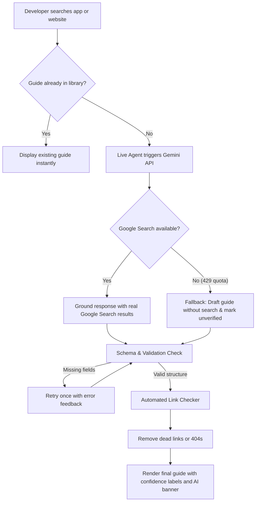

# OAuth Path

A guide library with a live research agent. A developer searches an app and gets a guide that shows how hard its OAuth setup is, how long approval takes, what can block them, and what to do next.

Live site: https://composio-project-mauve.vercel.app/
Repo: https://github.com/shivvering/Composio-Project

## What OAuth is, in my words
OAuth lets one app use your data in another app without ever seeing your password. When a developer builds an AI agent, their users want to connect apps like Google or Slack. To allow that, the developer often has to create an "OAuth app" with the provider and sometimes get it approved. That setup is confusing and can take an hour or several weeks.

## The problem I focused on
Developers cannot easily tell how hard setup will be and what might block them. So each guide starts with a quick summary (difficulty, setup time, approval wait), then requirements, steps, common blockers, and what an agent can do versus what the developer must do.

## My background
I come from a non programming background. I spent the first day learning what OAuth is and how Composio fits in, then built the app with Antigravity.

## How to run it
1. Run npm install.
2. Copy .env.example to .env.local and add your GEMINI_API_KEY.
3. Run npm run dev.
Credentials are not in the repo.

## How it works
Note for reviewers: if a guide says "unverified" or "generated without web search", the free Gemini limit has been reached for the day.

1. A developer searches an app name or website.
2. The app asks Gemini (model gemini-flash-lite-latest) to search Google and read real pages.
3. Gemini fills in a fixed guide template. Every field has a label: From official docs, Community reported, Estimate, or Could not confirm. If it cannot find something, it says "Not stated in sources" instead of guessing.
4. My code checks the guide has every required part. If not, Gemini tries once more.
5. My code checks every source link opens. Dead links are removed.
6. The guide is shown with a banner saying it is AI generated.
If Google Search is not available (for example the free quota ran out), the agent writes the guide without search and marks it unverified.

## What an agent can do and what you must do
The agent reads documentation and writes the guide. It cannot create your app, accept the provider's terms, record your demo video, or pass a review. Those are for the developer, and each guide lists them.

## Why these choices
- Same format for every guide so apps are easy to compare.
- Labels on each fact so developers know what to trust.
- Link checking so sources are real.
- A short summary at the top because developers want a fast answer.
- A Verification Log that shows what I corrected.

## What I tested and what I only read
- Tested myself: I created a Google OAuth app in testing mode and set up basic scopes (31 October).
- Live generation: I searched Asana, a nonsense name, a calculator app, and a website address. The nonsense name said no documentation exists. The calculator app said it does not need OAuth registration. The website address gave the same Asana guide. My free Gemini quota ran out during testing, so the Asana guide was written without search and marked unverified, which is how the fallback is designed to work. [Add after tomorrow's retest: Once the quota reset, Asana gave a guide with real source links.]
- Shared links and phone: I opened a guide link in a private window and it loaded. The site looks fine on my phone.
- Source links: I clicked every link in the Notion, Slack and GitHub guides (14 unique links in total) and found 0 dead links.
- Everything else I only read in the official documentation. The Verification Log says which is which.

## What the agent got wrong and what I changed
- Slack: the first guide said public distribution needs App Directory review. Slack's documentation says only a Marketplace listing needs review. I corrected it.
- Google: the first guide mixed up sensitive and restricted scopes and had numbers with no source, "2 to 6 weeks" and "$3,000 audits". I separated the two types and relabelled or removed those numbers.
- The first guides used wording like "tested" and "manually verified" that was not true. I removed it.
I found these by reading the guides against the official docs, with help from Claude as a reviewer.

## Limitations
- Labels are assigned by AI, and a working link does not prove a claim is right.
- Only 7 guides are pre checked. 4 others were generated live and are not checked.
- Generated guides are stored in temporary storage, so a shared link can stop working.
- I use the free Gemini plan, which has a small daily limit that resets at midnight Pacific Time. When the limit is reached, the app still writes a guide but without Google Search, and the page says "Generated without web search. Treat everything on this page as unverified." If you see this, it is because of the free plan limit, not a bug. Trying again after the reset gives a guide with real sources.
- I did not create apps or go through approval for Slack, Notion, Linear or Stripe. I did not test Google beyond basic scopes.
- The guides can go out of date because providers change rules.

## Tools used
Claude for planning and reviewing, Antigravity for building, Wispr Flow for dictation, Gemini inside the app.

## Disclosure
I built this for a Composio assignment. Composio sells managed OAuth, so I have tried to keep the guides neutral.

## Time spent and what I cut
About two days: day one learning and building, day two testing and fixing. I did not build 100 guides, accounts for every provider, or user logins.
